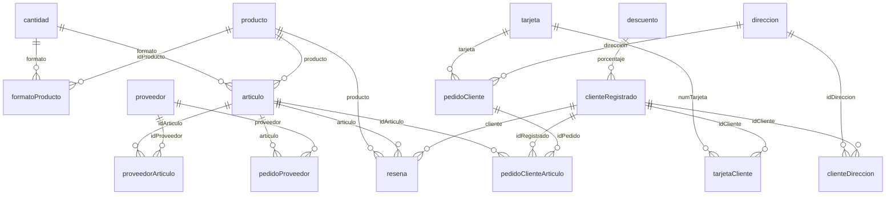

# Base de datos de una tienda de café en línea (SQL y PL/SQL)

[Español](#español) · [English](#english)

## Español

### En resumen

- **Qué:** la base de datos relacional de una tienda de café en línea, en Oracle. Incluye el diseño del modelo, la migración de los datos desde tres tablas sin normalizar y la lógica que trabaja sobre ellos: consultas de ventas, un paquete PL/SQL, vistas y disparadores.
- **Contexto:** las dos prácticas de Ficheros y Bases de Datos del Grado en Ingeniería Informática (UC3M, curso 2023-2024), hechas en equipo con Alex Rodríguez Carbonero y Miguel Jimeno Casas. Los tres trabajamos juntos en todas las partes.
- **Tecnologías:** Oracle Database, SQL y PL/SQL.

El código se ejecutó en el servidor Oracle de la universidad, con datos que no son públicos. Este repositorio contiene el código, no los datos, así que no se puede ejecutar tal cual.

### Parte 1: diseño y migración

La empresa tenía sus datos en tres tablas planas: el catálogo con los proveedores, los pedidos con los datos de cada cliente repetidos en cada línea, y los comentarios.

- **`01_creacion_tablas.sql`** crea el modelo nuevo: 16 tablas y 2 secuencias, con claves primarias y ajenas, restricciones `UNIQUE` y `CHECK` y reglas de borrado. El diagrama de arriba muestra las tablas y sus relaciones.
- **`02_carga_datos.sql`** migra los datos con 15 sentencias `INSERT … SELECT`:
  - Separa en columnas el formato del producto, que venía en un solo texto, con `SUBSTR` e `INSTR`.
  - Convierte a `DATE` las fechas y horas que venían como texto en columnas separadas.
  - Elimina duplicados con `DISTINCT` y descarta las filas a las que les falta un dato obligatorio.
  - Genera con secuencias las claves de direcciones y pedidos, y las recupera después con `JOIN` para enlazar las tablas dependientes.
  - Reúne en una sola tabla las direcciones de facturación y de entrega con `UNION`.

### Parte 2: consultas y PL/SQL

La segunda práctica parte de un modelo común de 16 tablas que proporcionó la asignatura (productos, referencias, proveedores, pedidos de reposición, clientes, pedidos registrados y anónimos, y comentarios). Ese script es material del curso y no está en el repositorio.

| Fichero | Qué hace | Qué usa |
|---|---|---|
| `consultas/01_variedad_mas_vendida_por_pais.sql` | Variedad de café más vendida en cada país en 2023, con sus compras, unidades e ingresos, y cuántos países suponen más del 1&nbsp;% de las ventas de esa variedad | 12 expresiones de tabla (`WITH`) encadenadas, `UNION` de compras registradas y anónimas, agregación en dos niveles |
| `consultas/02_referencia_mas_vendida_por_mes.sql` | Informe mensual de abril de 2023 a marzo de 2024: referencia más vendida de cada mes, con pedidos, unidades, ingresos y beneficio | Expresiones de tabla, agrupación por mes con `TO_CHAR`, máximo por grupo mediante `JOIN` |
| `paquete_caffeine/caffeine.sql` | `set_replacement_orders` confirma los borradores de pedidos de reposición. `informe_proveedor` muestra, para un proveedor, sus pedidos del último año, el plazo medio de entrega y, por referencia, el coste actual, mínimo y máximo y su diferencia con la media y con la mejor oferta de otros proveedores | Paquete con especificación y cuerpo, cursor implícito (`FOR … IN (SELECT …)`), `SELECT … INTO`, excepciones |
| `vistas/vistas_cliente.sql` | Tres vistas para el cliente que ha iniciado sesión: sus compras, su perfil y sus comentarios. Los comentarios solo se pueden editar o borrar si tienen cero *likes* | Paquete con estado de sesión, vistas, disparadores `INSTEAD OF` |
| `disparadores/01_endorsed.sql` | Marca un comentario como verificado si el usuario había comprado esa referencia | Disparador `BEFORE INSERT OR UPDATE` |
| `disparadores/02_baja_cliente.sql` | Al dar de baja un cliente, pasa sus pedidos y comentarios a las tablas anónimas | Disparador `AFTER DELETE` |
| `disparadores/03_tarjeta_registrada.sql` | Rechaza una compra anónima con una tarjeta guardada por un cliente registrado | Disparador `BEFORE INSERT`, `RAISE_APPLICATION_ERROR` |
| `disparadores/04_actualizar_stock.sql` | Tras cada compra descuenta el stock y, si baja del mínimo, crea un borrador de pedido al proveedor más barato para volver al stock máximo | Disparadores `AFTER INSERT` sobre las dos tablas de compras |

Los ficheros `*_pruebas.sql` contienen los datos y las sentencias con las que se probó cada elemento.

### Orden de ejecución

En SQL\*Plus o SQL Developer, con las tablas de origen y el modelo de la asignatura disponibles:

1. `01-diseno-y-migracion/01_creacion_tablas.sql` y después `02_carga_datos.sql`.
2. En `02-consultas-y-plsql/`: el paquete `caffeine`, las vistas y los disparadores; después los ficheros de pruebas y las consultas.

### Limitaciones

- No se incluyen ni las tablas de origen ni el modelo de la segunda práctica, por lo que el código no se ha vuelto a ejecutar para este repositorio.
- Es código de segundo curso y la lógica es la que se entregó. Solo se ha ordenado: se ha separado en ficheros, se han quitado bloques comentados, se ha corregido una errata en una restricción `CHECK` y se ha añadido `/` al final de cada bloque PL/SQL.
- Las dos consultas tienen el periodo escrito a mano en lugar de calcularlo a partir de la fecha actual.

### Autores

David Naranjo Mateos, Alex Rodríguez Carbonero y Miguel Jimeno Casas. Ficheros y Bases de Datos, Grado en Ingeniería Informática, Universidad Carlos III de Madrid, curso 2023-2024.

## English

### In short

- **What:** the relational database of an online coffee shop, in Oracle. It covers the model design, the migration of the data from three denormalised tables, and the logic that works on it: sales queries, a PL/SQL package, views and triggers.
- **Context:** the two assignments of the Files and Databases course, Computer Science and Engineering degree (UC3M, 2023-2024), done in a team with Alex Rodríguez Carbonero and Miguel Jimeno Casas. The three of us worked together on every part.
- **Tech:** Oracle Database, SQL and PL/SQL.

The code ran on the university's Oracle server, on data that is not public. This repository holds the code, not the data, so it cannot be run as it is.

### Part 1: design and migration

The company kept its data in three flat tables: the catalogue with its suppliers, the orders with each customer's details repeated on every line, and the reviews.

- **`01_creacion_tablas.sql`** creates the new model: 16 tables and 2 sequences, with primary and foreign keys, `UNIQUE` and `CHECK` constraints and delete rules. The diagram above shows the tables and their relationships.
- **`02_carga_datos.sql`** migrates the data with 15 `INSERT … SELECT` statements:
  - It splits the product format, which came as a single string, into columns with `SUBSTR` and `INSTR`.
  - It converts dates and times, stored as text in separate columns, to `DATE`.
  - It removes duplicates with `DISTINCT` and drops rows that lack a required value.
  - It generates address and order keys with sequences and looks them up again with a `JOIN` to link the dependent tables.
  - It merges billing and delivery addresses into one table with `UNION`.

### Part 2: queries and PL/SQL

The second assignment starts from a common 16-table model provided by the course (products, references, suppliers, replenishment orders, customers, registered and anonymous orders, and reviews). That script is course material and is not in the repository.

| File | What it does | What it uses |
|---|---|---|
| `consultas/01_variedad_mas_vendida_por_pais.sql` | Best-selling coffee varietal in each country in 2023, with its purchases, units and revenue, and how many countries account for more than 1% of that varietal's sales | 12 chained common table expressions (`WITH`), `UNION` of registered and anonymous purchases, two-level aggregation |
| `consultas/02_referencia_mas_vendida_por_mes.sql` | Monthly report from April 2023 to March 2024: best-selling reference each month, with orders, units, revenue and profit | Common table expressions, grouping by month with `TO_CHAR`, per-group maximum through a `JOIN` |
| `paquete_caffeine/caffeine.sql` | `set_replacement_orders` confirms draft replenishment orders. `informe_proveedor` reports, for one supplier, its orders in the last year, the average delivery time and, per reference, the current, minimum and maximum cost and the gap to the average and to the best offer from other suppliers | Package with specification and body, implicit cursor (`FOR … IN (SELECT …)`), `SELECT … INTO`, exceptions |
| `vistas/vistas_cliente.sql` | Three views for the logged-in customer: purchases, profile and reviews. Reviews can only be edited or deleted while they have zero likes | Package with session state, views, `INSTEAD OF` triggers |
| `disparadores/01_endorsed.sql` | Flags a review as verified if the user had bought that reference | `BEFORE INSERT OR UPDATE` trigger |
| `disparadores/02_baja_cliente.sql` | When a customer is removed, moves their orders and reviews to the anonymous tables | `AFTER DELETE` trigger |
| `disparadores/03_tarjeta_registrada.sql` | Rejects an anonymous purchase paid with a card stored by a registered customer | `BEFORE INSERT` trigger, `RAISE_APPLICATION_ERROR` |
| `disparadores/04_actualizar_stock.sql` | After each purchase it reduces the stock and, if it falls below the minimum, creates a draft order to the cheapest supplier to return to the maximum stock | `AFTER INSERT` triggers on both purchase tables |

The `*_pruebas.sql` files hold the data and statements used to test each element.

### Execution order

In SQL\*Plus or SQL Developer, with the source tables and the course model available:

1. `01-diseno-y-migracion/01_creacion_tablas.sql`, then `02_carga_datos.sql`.
2. In `02-consultas-y-plsql/`: the `caffeine` package, the views and the triggers; then the test files and the queries.

### Limitations

- Neither the source tables nor the model for the second assignment are included, so the code has not been re-run for this repository.
- It is second-year code and the logic is what was submitted. It has only been tidied: split into files, commented-out blocks removed, one typo in a `CHECK` constraint fixed and `/` added after each PL/SQL block.
- Both queries have the period written by hand instead of computing it from the current date.

### Authors

David Naranjo Mateos, Alex Rodríguez Carbonero and Miguel Jimeno Casas. Files and Databases, Computer Science and Engineering degree, Universidad Carlos III de Madrid, 2023-2024.
